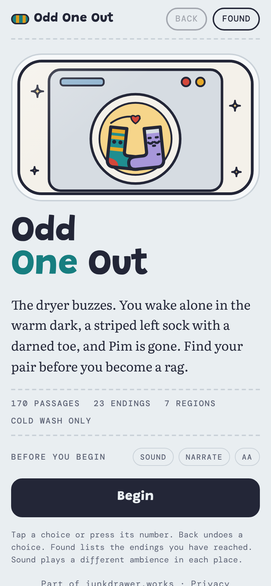
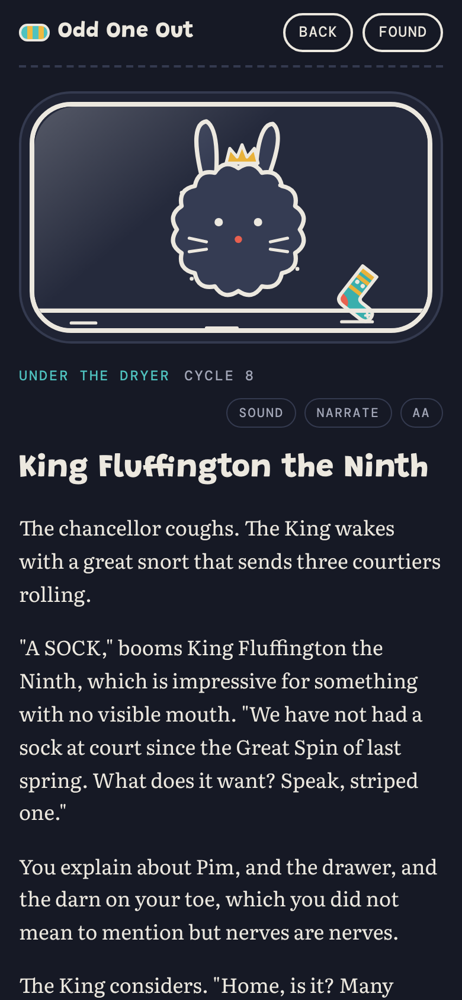
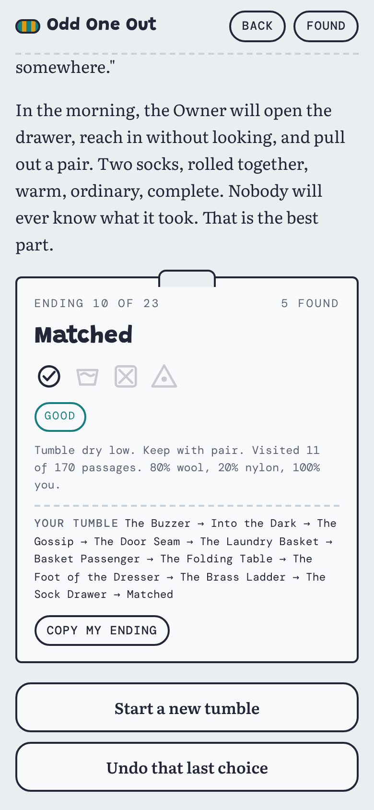

# Odd One Out

**Play it: [odd-one-out.junkdrawer.works](https://odd-one-out.junkdrawer.works/)**

**A choose-your-own-adventure where you are a sock lost in the dryer.** You wake alone in the warm drum, a striped left sock with a darned toe, and Pim, your pair, is gone. Almost every page ends in two or three choices. Find Pim before you end up a rag, or wander off and find something else: there are 170 pages, 23 endings and seven places to get lost in, from under the dryer to the junk drawer.

<p align="center">
  
  &nbsp;
  
  &nbsp;
  
</p>

## How it plays

- **Tap a choice** (or press its number) to turn the page. Some choices only appear once you've picked something up or met someone earlier on.
- **Back** undoes a choice. Keep pressing it to retrace your steps.
- **Every ending is a care label:** its name, whether it's good, bittersweet, bad or just weird, and the way you came. Copy my ending puts it on the clipboard to send to someone.
- **Found** lists the endings you've reached and the places you've been, with a dot for every page.
- **Sound** plays a different made-up ambience in each place, **Narrate** reads each page aloud in the browser's own voice, and **Aa** steps through four text sizes.
- No account and no server. Your place and the endings you've found stay in your browser, so it picks up where you left off. It works offline and installs to a phone's home screen.

## Running it

It's a static site: plain HTML, CSS and JavaScript, with no build step to play it.

```sh
npx serve .                   # or any static file server, then open the printed address
npm test                      # checks the story, then reads it in Chromium through the real page (needs Playwright)
node tools/build.mjs          # after editing story/*.json: checks every page can be reached, then rebuilds js/story.js
node tools/screenshots.mjs    # redraws docs/*.png and og.png
node tools/make-icons.mjs     # redraws the PNG icons from icon.svg
```

To put it online with GitHub Pages: **Settings → Pages → Build and deployment → Deploy from a branch**, then pick `main` and `/ (root)`.

### Files

- `story/*.json`: the book, one file per place. A page has an id, a title, a picture, its text and its choices; a choice can need a flag or be hidden by one, and a page can set one.
- `tools/build.mjs`: merges the story and refuses to build if a choice points nowhere, a picture is missing, any page or ending can't be reached with the flags as you'd play them, some way through can never reach an ending, or a page that talks about an earlier meeting (Counting, after Madame Purl's questions) can be reached without it. It writes `js/story.js` and `dist/artifact.html`, a single-file copy for the Claude Artifact viewer (`dist/` isn't committed).
- `js/app.js`: the reader: pages, choices, flags, saves, the care labels and the Found panel.
- `js/art.js`: the 68 drawings, as SVG coloured by CSS variables, so the dark palette repaints them.
- `js/sound.js`: the ambience for each place, generated with WebAudio (no sound files), and the narration.
- `fonts/`: Grandstander, Literata and DM Mono (SIL Open Font License), served from here so nothing loads from elsewhere.
- `sw.js`: keeps a copy of the book for reading offline.
